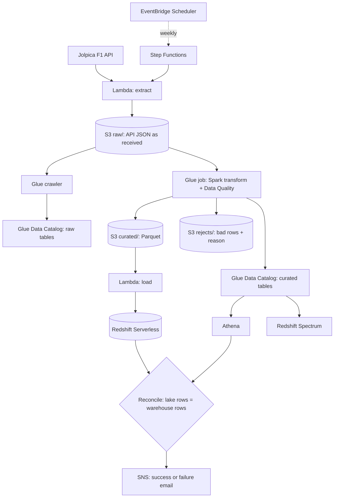
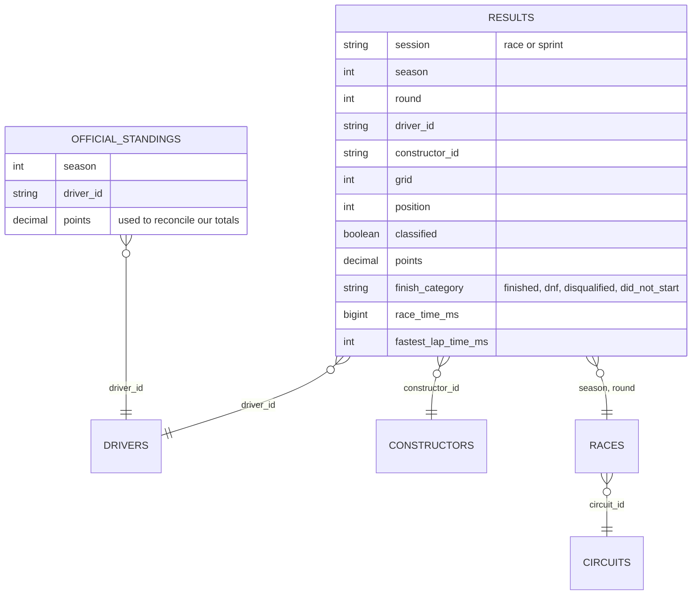

# AWS F1 Data Pipeline

A production-style batch data pipeline on AWS. It pulls Formula 1 results from a public REST API, lands them untouched in an S3 data lake, cleans and models them with AWS Glue (Spark), validates them with Glue Data Quality, loads them into Amazon Redshift Serverless, and reconciles the warehouse against the lake on every run. Step Functions orchestrates it, Terraform deploys it, and GitHub Actions tests it.

The data is real: every race and sprint result from 2021 to the current season, from the [Jolpica F1 API](https://github.com/jolpica/jolpica-f1) (the successor to Ergast).

## Architecture



Each run: **extract** the requested seasons, **transform** them while the crawler catalogs the raw zone, **load** the warehouse in one transaction, **count** the same table in the lake with Athena, and **reconcile**. If the counts differ, or any step fails, the run fails and SNS sends the error.

## AWS services and why each is here

| Service | Role in this pipeline |
|---|---|
| **S3** | The data lake. One encrypted, versioned, private bucket with `raw/`, `curated/` and `rejects/` zones. |
| **Lambda** | Extract (API to raw zone, with throttling and retries) and load (Redshift through the Data API). Arm64 for lower cost. |
| **Glue job** | Glue 5.0 Spark job: flattens nested JSON, types it, removes duplicates, rejects bad rows, builds 6 tables. |
| **Glue Data Quality** | DQDL rules (completeness, primary key, allowed values) that must pass before data is published. |
| **Glue Data Catalog** | Table definitions shared by Athena and Redshift Spectrum. |
| **Glue crawler** | Discovers the raw JSON's schema so the raw zone can be browsed in Athena. |
| **Athena** | Serverless SQL on the lake. Used by the pipeline to count lake rows for reconciliation, with a 1 GB per-query scan limit. |
| **Redshift Serverless** | The warehouse. Distribution and sort keys, transactional reloads, a daily compute cap. |
| **Redshift Spectrum** | Queries the lake's Parquet in place from Redshift, through the Glue Data Catalog. |
| **Step Functions** | Orchestration with retries, a parallel branch, error handling and a reconciliation gate. |
| **EventBridge Scheduler** | Weekly incremental run of the current season (off by default). |
| **SNS** | Success and failure notifications. |
| **CloudWatch** | JSON logs, Glue job metrics, and an alarm on failed runs. |
| **X-Ray** | Traces across Step Functions and Lambda. |
| **Secrets Manager** | Holds the Redshift admin password, generated by Redshift. No password exists in code. |
| **IAM** | One role per component, each limited to what it touches. |

Infrastructure is defined in Terraform (`infra/`). It's cloud-neutral, and the same skills carry to any provider.

## Data model



`results` is the fact table (one row per driver per race or sprint). `drivers`, `constructors`, `circuits` and `races` are dimensions. `official_standings` comes straight from the API and exists only to check our numbers against.

## Data quality, built in

- **Raw is immutable.** API responses are stored exactly as received, so any run can be replayed without calling the API.
- **Explicit schemas.** Raw JSON is read with a fixed schema, so an API change fails loudly instead of drifting silently.
- **Reject, don't drop.** Rows that fail a rule go to `rejects/` with a reason (`missing_key`, `bad_number`, `duplicate_result`, `negative_points`).
- **Every row accounted for.** The job fails unless `raw rows = clean rows + rejected rows`.
- **Glue Data Quality rules** gate publishing: completeness, a composite primary key, allowed values, non-negative points.
- **Lake and warehouse reconcile.** Step Functions compares Athena's row count with Redshift's after every load.
- **Business reconciliation.** Points computed from race and sprint results match the official standings for every driver in every season (see `01_reconcile_points.sql`).

## Quick start

Requirements: [uv](https://docs.astral.sh/uv/), Docker (for local Spark), and for AWS, Terraform 1.10+ and a logged-in AWS CLI.

**Locally, no AWS account needed:**

```bash
make install     # dev tools into .venv
make check       # lint, type check, unit tests, Spark tests
make extract     # pull 2021 to current season from the API into data/raw
make transform   # run the Glue job locally with Spark 3.5 (same as Glue 5.0)
make preview     # run the analytics SQL on the local Parquet with DuckDB
```

**On AWS:**

```bash
cp infra/terraform.tfvars.example infra/terraform.tfvars   # optional: alert email, schedule
make deploy                      # terraform apply
make run SEASONS=2021-current    # start the pipeline and wait for it
make query                       # analytics SQL on Redshift
make teardown                    # terraform destroy
```

Sample output of `make preview`, the same SQL that runs on Redshift:

```
Reconciliation: points we computed from race and sprint results vs the official standings

season  drivers  matching  mismatched
------  -------  --------  ----------
  2021       21        21           0
  2022       22        22           0
  2023       22        22           0
  2024       24        24           0
  2025       21        21           0
  2026       23        23           0
```

## Cost

Everything is pay-per-use, and nothing runs unless you start it. A full run of six seasons costs a few cents.

- **Redshift Serverless:** 4 RPUs (the minimum), billed only while queries run, capped at 4 RPU-hours a day. Past the cap, the workgroup turns itself off.
- **Glue:** 2 workers (the minimum) on Flex execution (about a third cheaper), 10-minute timeout.
- **Athena:** about 1 MB scanned per run, with a 1 GB per-query cutoff.
- **Lambda, Step Functions, SNS, Scheduler:** within the AWS free tier at this volume.
- **The schedule is off by default**, and `make teardown` removes everything.

## Project layout

```
src/f1_pipeline/
  extract/            API client (throttle, retry, paginate), raw-zone writers, Lambda handler
  load/               Lambda handler: transactional Redshift load
  sql/warehouse/      schema, load, Spectrum, row counts
  sql/analytics/      reconciliation and analysis queries
  warehouse.py        Redshift Data API client
  query.py            run analytics on Redshift or locally with DuckDB
glue/transform_f1.py  Glue job (also runs locally with spark-submit)
infra/                Terraform: one file per area (storage, glue, lambda, redshift, athena, orchestration)
tests/unit/           pytest: extract, warehouse, load
tests/spark/          Spark tests for the Glue job
docs/                 runbook and interview guide
```

## More

- [Runbook](docs/runbook.md): deploy, backfill, rerun, investigate failures, tear down.
- [Interview guide](docs/interview-guide.md): talking points, likely questions, and how this maps to other stacks (Databricks, Snowflake, Teradata and Ab Initio).
